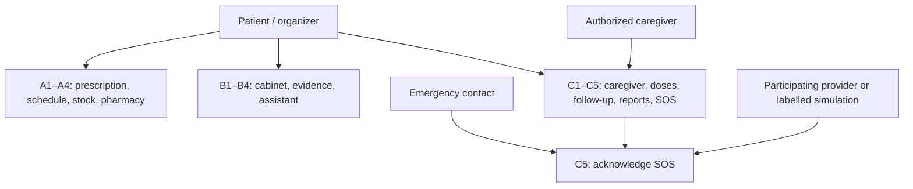
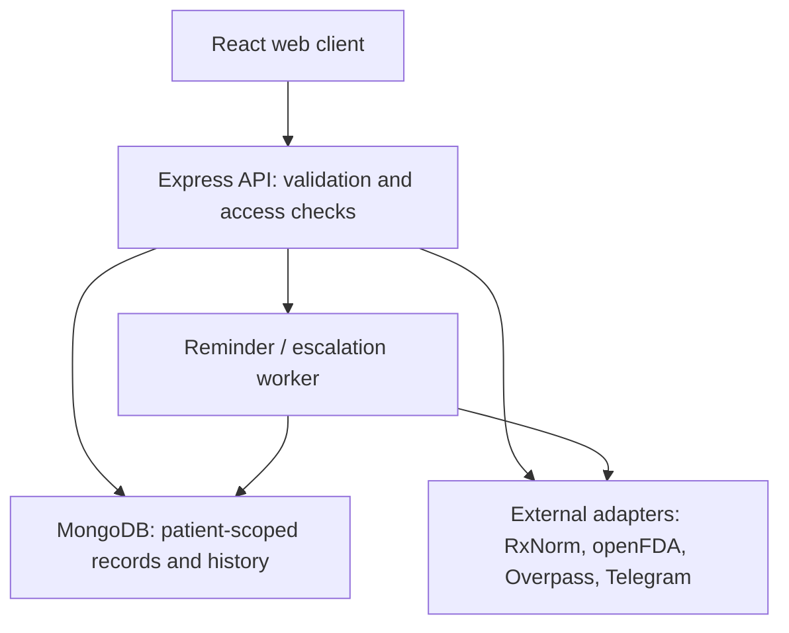
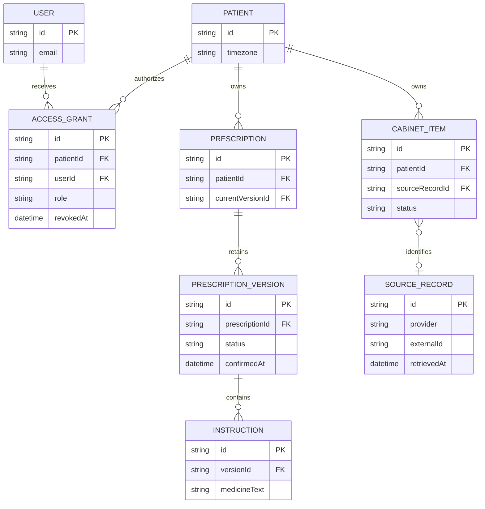
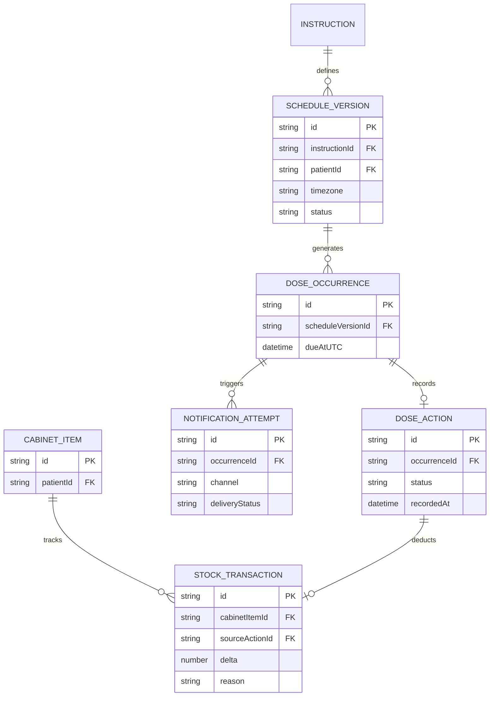
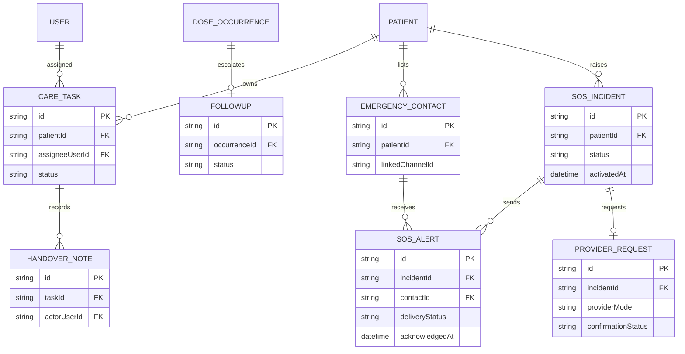
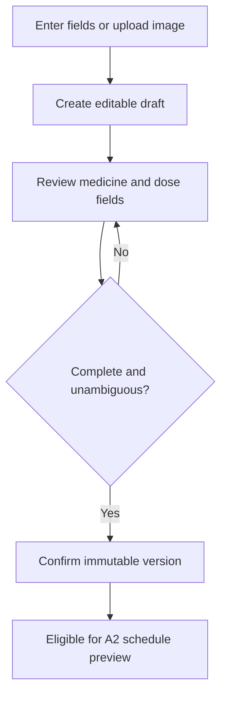
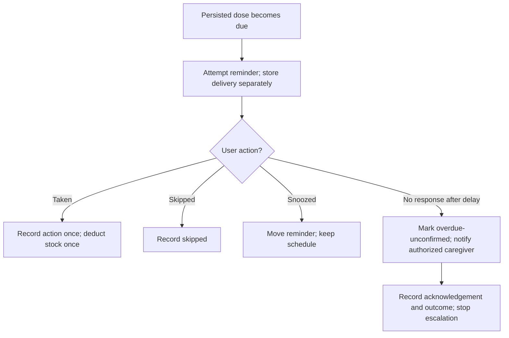
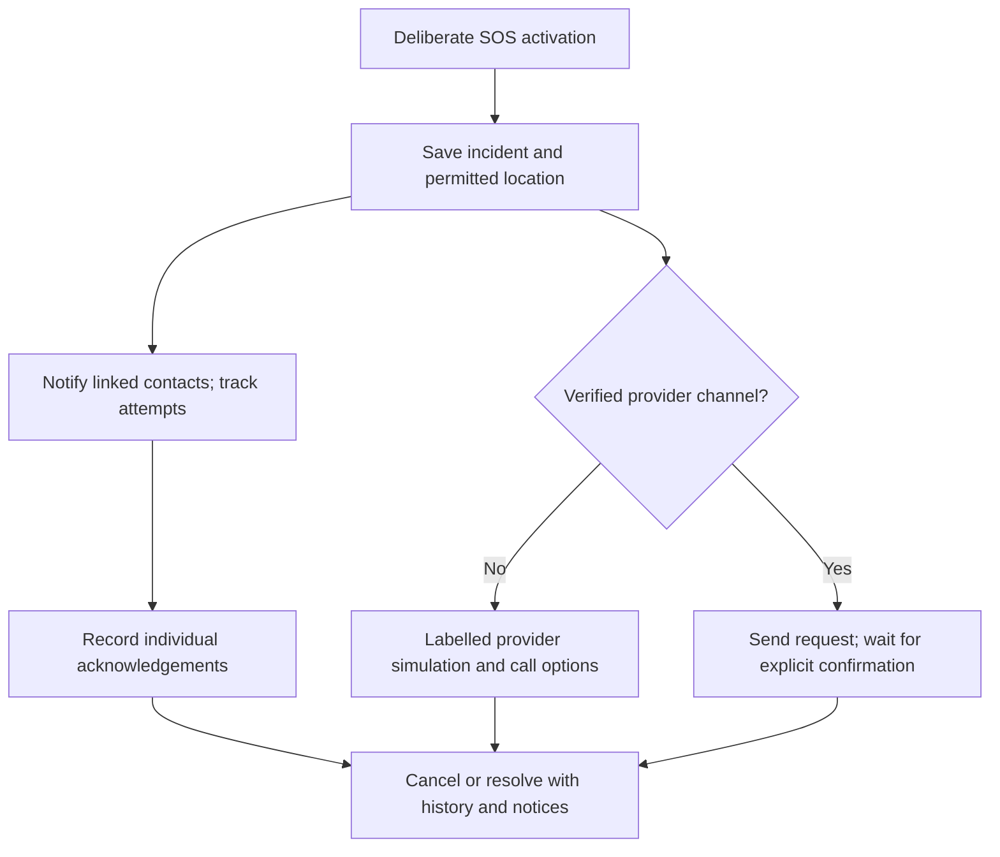

# Step 13 — MediMate design models

**Status:** proposed design, 1 November 2026. These models guide implementation; the Step 10 notes demo is not the production data model. Confirm exact faculty diagram notation and report format before submission. Requirements: [13 functions](REQUIREMENTS.md) and [acceptance checks](STEP_11_ACCEPTANCE.md).

## 1. Actors and use cases

Mermaid does not provide a native UML use-case shape, so the following is a readable actor-to-use-case map. When a formal UML diagram is required, reproduce the same actors and ovals in Figma or a UML editor. External services are supporting systems, not human actors.

| Actor | Main use cases | Access boundary |
|---|---|---|
| Patient / household organizer | Confirm prescription (A1), build schedule (A2), manage stock/refill (A3–A4), cabinet and evidence (B1–B4), tasks and dose record (C1–C2), reports (C4), SOS (C5) | Own patient record, or expressly authorized record |
| Authorized caregiver | Accept and complete assigned tasks (C1), respond to dose follow-up (C3), view permitted reports (C4), acknowledge SOS (C5) | Only records and actions permitted by active grant |
| Emergency contact | Receive and acknowledge SOS (C5) | Linked channel and minimal incident information; not general patient access |
| Participating provider | Receive and confirm an ambulance request (C5) | Only through a verified provider channel; classroom provider is simulated |
| External data/notification services | Medicine terminology, label evidence, pharmacy listings, Telegram delivery | Integration failures are shown; services cannot authorize access to patient records |

**Use-case relationships:** A2 requires confirmed A1 instructions; C2 requires confirmed A2 schedule; A3 uses C2 taken events; C3 monitors unanswered C2 events; A4 may create C1 tasks; C4 reads confirmed records and events; C5 is a direct user trigger, independent of C3.

## 2. System architecture

The browser sends authenticated requests to the API. The API verifies the actor and an active patient access grant on every protected operation. External adapters normalize responses, keep source IDs and retrieval times, and return an unavailable state when an integration fails. The worker queries persisted due events so a restart can resume processing; a process that is asleep or offline cannot guarantee timely delivery. C5's simulated provider is an explicitly labelled development adapter, never a real dispatcher. The current Step 10 notes API lacks authentication and must stay a localhost demo.

### Logical modules and boundaries

| Module | Responsible data/operations | Depends on |
|---|---|---|
| Identity/access | User, patient profile, access grants; revoke access | Shared foundation |
| Prescriptions | Draft, OCR review, confirmed immutable versions | Identity |
| Medicine knowledge | Cabinet items, external source references, evidence, assistant history | Identity; terminology/label adapters |
| Schedules/doses | Versioned schedules, occurrences, actions, notification attempts | Confirmed prescriptions; identity |
| Inventory/pharmacy | Ledger, refill checklist, listing snapshot and collection task | Dose action; caregiver tasks; Overpass |
| Caregiving/SOS | Tasks, handovers, follow-up, emergency incidents and acknowledgements | Grants; schedules/doses; Telegram; provider simulation |
| Reports | Date range queries and PDF output | Patient-scoped read models across modules |

## 3. Database relationship model

MongoDB documents can embed small immutable snapshots or use references. The diagrams show *logical* entities and cardinalities, not a commitment to one collection per box. Every patient record carries `patientId`; each actor action carries `actorUserId`; server authorization checks the active grant rather than trusting a client-supplied patient ID. Define IDs as MongoDB ObjectIds or UUIDs consistently during Step 15.

### Identity, prescriptions and cabinet

A confirmed version is retained even after a replacement. Draft OCR output cannot directly generate an active schedule. `SOURCE_RECORD` is optional: manual entries are visibly marked, and source passages must retain a URL/identifier and retrieval time.

### Schedule, doses and stock

Store times in UTC plus the schedule's timezone. Enforce at most one effective dose action per occurrence and at most one stock deduction per taken action with unique database keys/atomic operations. Snooze changes a notification attempt/due reminder, never the prescription or scheduled dose. Correct a recorded action through an auditable correction flow rather than erasing history. Inventory balances derive from ledger entries.

### Caregiving, follow-up and SOS

An emergency contact's Telegram link does not itself grant access to the patient's chart. SOS location is optional and shared only with permitted recipients. An alert attempt, recipient acknowledgement, provider acceptance and ambulance dispatch are distinct states. No real provider request exists without a verified participant.

### Proposed indexes and consistency rules

- `ACCESS_GRANT(patientId,userId)` to check active permission.
- `PRESCRIPTION_VERSION(prescriptionId,versionNumber)` unique.
- `DOSE_OCCURRENCE(scheduleVersionId,dueAtUTC)` unique; `DOSE_ACTION(occurrenceId)` unique for effective action.
- `STOCK_TRANSACTION(sourceActionId,reason)` unique when reason is dose deduction.
- `FOLLOWUP(occurrenceId)` unique; `SOS_ALERT(incidentId,contactId)` unique per contact/attempt key.
- For stock and reminder processing, use atomic writes or a transaction and a retry-safe key. Verify the exact transaction strategy against the selected MongoDB deployment before coding.

## 4. Key activity flows

### A1: review and confirm prescription

If OCR fails, manual editing remains available. Replacing a confirmed prescription creates a new version and shows the differences; it never rewrites past dose events.

### C2/C3/A3: dose action and follow-up

A reminder delivery does not imply a dose was taken. A dose with no response remains unconfirmed, not automatically skipped. After restart, the worker scans due persisted events and reuses idempotency keys so retries do not duplicate alerts or deductions.

### C5: emergency assistance

## 5. Design review before implementation

1. Confirm whether faculty requires formal UML use-case notation and a particular ERD convention.
2. Agree naming, owner/patient identity, role permissions and record lifecycle at Step 15.
3. Decide how an authenticated household organizer differs from a patient and who can confirm prescription instructions.
4. Choose the schedule event generation horizon, timezone changes and restart policy.
5. Choose whether C5's simulated provider dashboard is accessible only to test accounts and how to label it.
6. Review source coverage for Bangladeshi medicine brands and specify an honest manual-entry flow.
